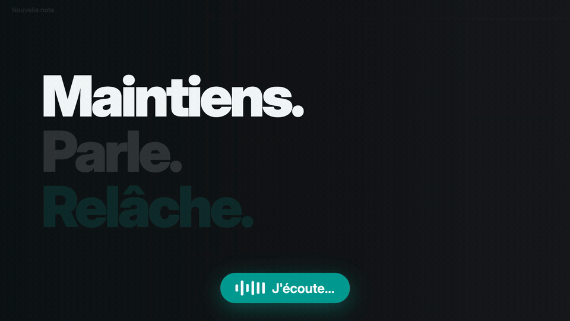

<p align="center">
  <picture>
    <source media="(prefers-color-scheme: dark)" srcset="logo/scriibe-logotype-windows-sombre.svg">
    
  </picture>
</p>

# Scriibe

🇬🇧 [English version](README.en.md)

Dictée vocale pour Windows, macOS et Linux. Maintenir une touche, parler, relâcher : le texte est transcrit, mis au propre et collé dans l'appli ouverte.

<p align="center">
  <a href="docs/media/scriibe-film-a.mp4"></a><br>
  <sub>Le film complet (65 s, avec le son) : <a href="docs/media/scriibe-film-a.mp4">scriibe-film-a.mp4</a> · Made with <a href="https://github.com/alchaincyf/huashu-motion">huashu-motion</a></sub>
</p>

Scriibe est la suite multiplateforme de [Scribe](https://github.com/scarou/scribe) (macOS, Swift), qui reste la **version de référence** du comportement. Le but est la même expérience sur les trois systèmes, avec un code unique (Rust + Tauri).

> **État : dernière version sur les [Releases](https://github.com/scarou/Scriibe/releases).** Détail des versions : [CHANGELOG.md](CHANGELOG.md) ; plan : [docs/ARCHITECTURE.md](docs/ARCHITECTURE.md) ; étapes : [ROADMAP.md](ROADMAP.md) ; essais par système : [docs/ESSAI_WINDOWS.md](docs/ESSAI_WINDOWS.md), [docs/ESSAI_MACOS.md](docs/ESSAI_MACOS.md), [docs/ESSAI_LINUX.md](docs/ESSAI_LINUX.md).

## Installer

Télécharge la dernière version sur les [Releases](https://github.com/scarou/Scriibe/releases), puis suis le guide pas à pas de ton système :

- **Mac** : [guide](docs/INSTALLATION_MACOS.md)
- **Windows** : [guide](docs/INSTALLATION_WINDOWS.md)
- **Linux** : [guide](docs/INSTALLATION_LINUX.md)

Tous les guides, pour débutants et pour connaisseurs :

- **Mac** (puce Apple, macOS 14 ou plus) : [pas à pas pour débutants](docs/INSTALLATION_MACOS.md) ([English](docs/INSTALLATION_MACOS.en.md)) · [guide pour connaisseurs](docs/INSTALLATION_MACOS_EXPERT.md) ([English](docs/INSTALLATION_MACOS_EXPERT.en.md)).
- **Windows** (10 ou 11, 64 bits) : [pas à pas pour débutants](docs/INSTALLATION_WINDOWS.md) ([English](docs/INSTALLATION_WINDOWS.en.md)) · [guide pour connaisseurs](docs/INSTALLATION_WINDOWS_EXPERT.md) ([English](docs/INSTALLATION_WINDOWS_EXPERT.en.md)).
- **Linux** (Ubuntu 25.04+ avec GNOME, ou session X11 ; expérimental) : [pas à pas pour débutants](docs/INSTALLATION_LINUX.md) ([English](docs/INSTALLATION_LINUX.en.md)) · [guide pour connaisseurs](docs/INSTALLATION_LINUX_EXPERT.md) ([English](docs/INSTALLATION_LINUX_EXPERT.en.md)) ; l'état de l'essai est dans [docs/ESSAI_LINUX.md](docs/ESSAI_LINUX.md), et on peut aussi compiler soi-même (voir « Pour les développeurs »).

Les moteurs locaux (Whisper, llama.cpp) sont installés ou téléchargés depuis l'application, avec l'accord de l'utilisateur à chaque téléchargement ; les moteurs en ligne (Deepgram, OpenRouter) demandent une clé personnelle.

## Principes

- **Local d'abord** : transcription par `whisper-server` (whisper.cpp) et mise au propre par `llama-server`, LM Studio ou Ollama ; le cloud (Deepgram, OpenRouter) reste un choix, jamais une obligation.
- **Le comportement est mesuré** : la logique de texte est vérifiée par des cas de référence (`fixtures/`) tirés de Scribe.
- **Ouvert** : licence MIT, développement en français, interface, Aide et procédures d'installation en français et en anglais ([README en anglais](README.en.md)).

## Pour les développeurs

**Compiler soi-même.** Prérequis : [Rust](https://rustup.rs) et [Node.js](https://nodejs.org). Ordre à respecter (l'interface est embarquée dans l'exécutable) :

```bash
cd ui && npm ci && npm run build && cd ..
cargo build --release
```

L'exécutable est `target/release/scriibe` (`scriibe.exe` sous Windows). Sur Mac, `tools/faire_app_macos.sh` en fait une `Scriibe.app`. Sous Linux, la compilation demande au moins `libasound2-dev` (voir `docs/ESSAI_LINUX.md` pour l'état).

## Licence

[MIT](LICENSE)
